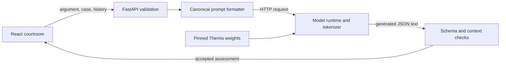

# Themis inference audit and implementation plan

Audit date: 5 November 2026. The full 617-line handoff was read before this audit. The primary working tree is `/home/sno/Work/dev/themis`; the older audit checkout was used only to compare published code. This plan incorporates Snow's GitHub Education access, existing use of molab/Kaggle/Colab, and preference for a card-backed service only when spending can be capped.

The immediate task is to run the published Themis checkpoint with its historical input format and connect that verified path to the existing courtroom. Reuse the application work. Start with a reference generation on an already accessible free graphics processing unit (GPU); investigate a small local model as a durable alternative. Modal is the leading candidate for subsequent capped hosting, conditional on account access and verified budget settings. See the [GPU comparison](gpu-options-2026-11-05.md).

This audit added documentation and evidence only. No existing source or configuration was edited, no weights were uploaded or downloaded in full, and no training, paid provisioning, publishing or live model generation occurred. Secrets were not inspected. A [machine-readable manifest](evidence/themis-audit-2026-11-05.json) records revisions, artifact hashes, measurements and reconstructed split indices.

## What already works and should be reused

The local commit is `67efe7012663130f342ad02b9b6561e025a35552`. The public GitHub HEAD was checked again and remains `dca3a7bf41b76ab774c1b28655d31950361c6fe4`. Initially there were **23 modified tracked paths and 25 untracked files**. The tracked diff contains 4,458 insertions and 4,468 deletions; untracked work is additional. Inspection included that diff, the current backend, frontend request/state paths, import handling, setup instructions, smoke check and test suites. Public code is substantially older than the application in this working tree. The application uses Hypertext Transfer Protocol (HTTP), a request/response protocol, to communicate with its backend and model server.

| Component | Observed implementation | Implication for the next change |
| --- | --- | --- |
| `backend/main.py` | Validated HTTP submissions, case search/import, counsel endpoint, configuration health and legacy WebSocket | Keep its application contract and failure responses. It delegates inference rather than loading a model. |
| `backend/judge.py` | Primary/legacy/fallback selection, chat client, four-score validation, contextual input construction and separate counsel generation | Most integration belongs here; a courtroom rewrite is unnecessary. |
| `backend/cases.py` | 56 sourced archive summaries; bounded, memory-only PDF/DOCX/text extraction | Preserve document review and complete extraction. Case size limits still need an inference-token check. |
| `frontend/src/hooks/useJudge.js` | HTTP orchestration, cancellation, session guards, score changes only after success, generated-opponent reuse on retry | Preserve these invariants while changing the model transport. |
| `frontend/src/store/gameStore.js` | Three rounds, both sides, two follow-ups per side per round, criterion averages and draw handling | Keep the four criteria and current hearing rules. |
| `frontend/src/utils/api.js`, `frontend/vite.config.js` | Browser timeouts and development `/api` proxy | Production must provide its own backend routing; the Vite development proxy is not hosting infrastructure. |
| `tests/`, `frontend/tests/` | Validation/fallback/import tests and complete browser journeys with a deterministic model fixture | Keep fixture checks fast and separate from real-model evaluation. |

Verification on the existing environments:

- **22 backend tests passed** with `.venv_global/bin/python -m unittest discover -s tests -p 'test_*.py' -v`.
- **16 browser tests passed** in about 1.3 minutes with the project Python environment on `PATH`. These include complete local and solo hearings, follow-up limits, retries, cancellation, imports, downloads and mobile keyboard behavior.
- Frontend lint, production build and `git diff --check` passed.
- Sandbox restrictions prevented the initial local-server run. The successful rerun used local socket access; this was an execution-environment restriction, not an application failure. The stalled initial test process was stopped.

The backend run used Python 3.14.9, FastAPI 0.136.1, Pydantic 2.13.4, Starlette 1.0.0, pypdf 6.18.0 and python-multipart 0.0.32. The frontend used Node 26.13.0; the installed build reported Vite 8.2.2. No project dependencies were changed. These passes establish application behavior with fixtures, not successful loading of Themis weights.

## Follow one argument through the intended system

Suppose a petitioner submits: “The university could require advance notice instead of banning every student meeting.” The browser supplies that argument, the reviewed case and recent hearing history to FastAPI, the Python web framework used by this application.

FastAPI validates the fields. A prompt formatter then arranges the relevant information as the text the trained model expects. A **tokenizer** turns that text into numbered units called tokens. An **inference runtime** loads the learned numerical weights and generates new tokens. Its decoded text should use **JavaScript Object Notation (JSON)**, a structured text format representing the four scores and the judge's response. The backend validates that object before the browser records scores and offers the next turn.



An **application programming interface**, or API, defines how programs exchange requests and responses. Model repositories store files; an inference API additionally needs a running process that loads those files and executes them. An OpenAI-compatible API describes a protocol, not the company hosting the model or the identity of its weights.

The app, model runtime and model storage can live on different machines. For the first hearing, the app can stay on the laptop. **Hosting** adds reachability and process management; it does not itself correct model formatting. A notebook is a useful temporary experiment environment, while an endpoint is a reachable service intended to accept requests.

## Published artifacts and model provenance

The public repositories are accessible without gating, and their current revisions match the handoff. The links below pin the audited versions.

| Artifact | Revision | Verified contents |
| --- | --- | --- |
| [Merged Themis model](https://huggingface.co/snowsadh/themis-judge-3b/tree/76dcb54684386249494d3c81fdb9183d721ca90d) | `76dcb54684386249494d3c81fdb9183d721ca90d` | Two weight shards, model configuration and tokenizer. Shards total 6,425,529,048 bytes including headers. |
| [Themis adapter](https://huggingface.co/snowsadh/themis-judge-lora/tree/93925c5bce68c777fbfd6018fdd9f617dcd90ae9) | `93925c5bce68c777fbfd6018fdd9f617dcd90ae9` | Adapter configuration, tokenizer files and a 97,307,544-byte adapter weight file. |
| [Dataset](https://huggingface.co/datasets/snowsadh/multiturn-legal-argumentation/tree/89d3fb1cda7e92dd4ad924e49b356d8b086a0186) | `89d3fb1cda7e92dd4ad924e49b356d8b086a0186` | 504 rows from 56 cases, equal as parsed records to local `utils/data/dataset.json`. |

**Architecture** is the arrangement of neural-network layers; **weights** are their learned numerical values. Themis reuses Llama 3.2-3B Instruct's architecture and pretrained weights. **Low-Rank Adaptation**, or LoRA, learns a smaller set of additional weights while the base weights remain frozen. **Quantized LoRA**, or QLoRA, uses a reduced-precision base during this training. The adaptation changes behavior without creating a new architecture.

The adapter records rank 16, alpha 16, zero dropout and seven target projection types. Its base is `unsloth/llama-3.2-3b-instruct-unsloth-bnb-4bit`, with no pinned base revision. A bounded download of its tensor header verifies **392 float32 tensors containing 24,313,856 parameters**. Thus “four-bit training” does not mean the saved adapter itself is four-bit. The adapter depends on compatible base weights. The merged repository supplies a full model representation and is the simpler first deployment candidate.

The Hub reports 3,212,749,824 parameters in the merged model, stored as **brain floating-point 16 (BF16)** values. BF16 and **16-bit floating-point (FP16)** are different two-byte number formats. The first weight shard's actual header confirms BF16 tensors; `config.json` nevertheless declares `torch_dtype: float16`. Loading precision must be selected explicitly and recorded. The evaluation log reports T4 hardware without BF16 support, so stored BF16 weights are not a reason to request unsupported BF16 computation on a T4.

The training notebook loads `unsloth/Llama-3.2-3B-Instruct` in four bits. The evaluation log explicitly says that Unsloth loads the legacy tokenizer from the adapter's recorded four-bit base path. This explains the naming relationship, but does not recover an immutable historical base-weight revision. Also, the downloaded notebook's Hub upload cells are commented out. Publication is verified by the Hub artifacts; an executed export trace tying the adapter and merged tensors together is still missing. Compare behavior before treating the two representations as interchangeable.

Training source specifies a 2,048-token maximum, batch size 2 with four gradient-accumulation steps, three epochs, learning rate `2e-4`, seed 69, epoch evaluation/checkpointing and device 0. It uses Transformers, Hugging Face's model library, and TRL (Transformer Reinforcement Learning), whose supervised fine-tuning trainer fits the provided input/target examples. The observed source pins Transformers 4.51.3 and TRL 0.15.2. The later evaluation log instead records Unsloth 2026.6.1, Transformers 5.5.0, TRL 0.24.0 and Torch 2.10.0+cu128. Those are different experimental environments; neither is automatically a tested deployment environment. Two visible T4s do not establish distributed training.

The current data-generation source uses DeepSeek to create examples and target assessments. That supervision is distinct from pretrained weights, the learned adapter, and Snow's human review. The current generator file is not an immutable record of the exact teacher version that produced every published row.

### A newly found local-runtime option

SHA-256 is a checksum algorithm that creates a fingerprint of a file's bytes; matching a published checksum verifies the downloaded bytes, not model quality or the publisher's source claim. [mradermacher's GGUF repository](https://huggingface.co/mradermacher/themis-judge-3b-GGUF/tree/92252039af0c158f9c82f0a192d7d306ace6622a) publishes conversions attributed to Snow's merged Themis model. **GGUF** is a model-file format used by llama.cpp, a runtime that can execute quantized models on a central processing unit, or CPU. The `Q4_K_M` variant uses mixed low-precision quantization and is **2,019,378,176 bytes**, with published SHA-256 `249f7941c164b63defb5e860ade42e362484cd9232b8a9d6000904e0c15eafd7`.

This file could avoid doing the conversion on the laptop. The repository revision, advertised checksum and first 64 KiB of the file were inspected. The inspected metadata does not prove the exact source commit. No complete-file hash or generation parity was checked. Keep it as a candidate: verify the download, compare against a reference and record the third-party conversion separately from Snow's original artifacts.

The laptop currently reports a Ryzen 7 7730U, roughly 14 GiB physical memory, 5.2 GiB available, and 4.8 GiB swap occupied; disk space is about 462 GiB free. These memory readings are transient. No `nvidia-smi` executable was found. A CPU test with the compact file is plausible, but response speed and running memory remain unmeasured. Do not assume NVIDIA's CUDA GPU software applies to the integrated AMD graphics.

## The input-format problem

The historical training text is a completion prompt: the model receives a prefix and continues it. Its input ends here:

```text
### Case Summary:
{case_summary}

### Legal Issue:
{legal_issue}

### Relevant Laws:
{relevant_laws}

### Side:
{side_in_uppercase}

### Opposing Counsel Argument:
{opposing_argument_or_None}

### Previous Judge Response:
{previous_response_or_None}

### CurrentArgument:
{current_argument}

### Judge Response:
```

The complete training example appends target JSON and `<|eot_id|>`. Inference supplies neither the expected JSON nor that terminal marker in the input. The published tokenizer inserts `<|begin_of_text|>` at the beginning; a sample tokenization confirmed its ID, 128000, and the complete sample's final token, 128009. The implementation must verify these boundaries through the chosen runtime so it does not insert two beginning tokens or stop too late.

The current app instead sends a system instruction plus a JSON user message through `/chat/completions`. The saved tokenizer has a Llama chat template, which can add role headers, dates and other text. The notebooks do not call `apply_chat_template` on their formatted training/evaluation examples. Shared field names therefore do not establish equivalent effective input.

There are further differences: the app uses lowercase side values, semicolons between authorities, JSON null for an absent opposing argument, and side-position fields absent from the training template. The historical formatter uses uppercase sides, preserves string authorities or comma-joins lists, and renders absent values as `None`. Reproduce that historical format first. Retain the current system/chat prompt for general-model fallback and counsel. A later prompt revision should be measured as a new experiment.

The preferred small integration is a primary raw-completions path while retaining the current chat path for other models. Both [vLLM](https://docs.vllm.ai/en/stable/serving/openai_compatible_server/) and [llama.cpp](https://github.com/ggml-org/llama.cpp/blob/master/tools/server/README.md) document completion and chat interfaces. Raw completion requests use `prompt`; an OpenAI-style completion response uses `choices[0].text`. The existing client expects `messages` and `choices[0].message.content`. Changing only the URL will fail. Verify the actual runtime's request, tokenization and stop behavior before implementing the client change.

## Context length and evaluation evidence

The tokenizer analysis used the pinned published tokenizer and exact notebook formatter. It inserted special tokens and did not truncate examples. This is a newly reconstructed measurement, not a historical training log. Full rows are equal to the local dataset; measurement versions and indices are in the manifest.

| Measurement | Result |
| --- | --- |
| Prompt tokens, minimum / median / maximum | 219 / 537 / 1,282 |
| Complete training sequence tokens, minimum / median / maximum | 296 / 644 / 1,390 |
| Complete sequences over 2,048 tokens | 0 of 504 |
| Target output tokens in reconstructed evaluation subset | Maximum 163; mean 109.51, matching the saved log |
| Rows with a previous judge response | 306; all have a non-null bench-handling target |
| Rows without a previous judge response | 198; all have a null bench-handling target |

The current imported-case limits are in characters, not model tokens. A **context window** is the runtime's capacity for the input and generated continuation together. A 30,000-character brief can pass application validation while exceeding a 2,048-token inference budget. The model's advertised 131,072-token positional capacity and the setup guide's proposed 32K window do not measure this adapter's quality on long briefs.

Begin reference generation within 2,048 total tokens. The historical 200-token output budget is appropriate for reproducing the old protocol; use a measured 256-token allowance for application experiments if needed. Count the exact final prompt and reserve output space. Reject an oversized request with an editable explanation before generation; do not silently cut case material or switch to a paid fallback to hide the input problem. Longer context is a separate evaluation milestone.

Historical evidence remains valuable:

- The saved log reports base-model parse failures on 51/51 rows and adapted-model failures on 0/51 under its parser. The adapted model's mean absolute errors are 1.7255, 0.9608, 0.5490 and 1.0000 across the four criteria; the average of the rounded criterion errors is 1.0588. Mean absolute error is the average absolute difference between prediction and target on the -3 to +3 score scale.
- All **ten saved fine-tuned showcase responses also pass the current stricter application parser**, checked during this audit. The summary and showcase do not contain all 51 raw outputs; do not extend this stricter-parser result to the other 41 without recovering or regenerating them.
- The exact NumPy permutation method was checked against the tagged source of `datasets` 4.3.0. The reconstructed 453/51 split matches all ten saved showcase rows, including arguments and targets. It has 56 training cases and 34 evaluation cases, with all 34 represented in training. This supports held-out-turn evaluation for this recovered version. The training notebook itself references an older dataset URL without a pinned revision, so its historical input identity still needs a recorded export or snapshot.
- Snow reports manually reviewing scoring and response quality, and using additional evaluation-only cases. Preserve that history as qualitative evidence while recovering the sample/version list. The current split reconstruction does not identify those other examples.

The historical parser extracts text between braces and checks for `delta_scores`; it does not enforce every field, strict integer type or contextual bench-score rule. The base model has no comparable numeric error in this run because every response failed that parser. The result demonstrates improved task-format adherence; it is not a measured score-accuracy win over a numerically scored base baseline. Targets are synthetic assessments, not independently calibrated legal marks. A model can emit valid JSON and still give a poor legal assessment.

## Prioritized findings

| Priority | Finding and code location | Required action |
| --- | --- | --- |
| P0: first inference | `backend/judge.py:139,167,212` and `scripts/check_model.py:22` use chat formatting rather than the recovered completion prefix | Establish a real reference, then share one canonical formatter and verified primary transport. |
| P0: evidence | No live Themis generation or complete real-model hearing is recorded by these checks | Save a pinned reference pair, then demonstrate a complete hearing with Themis explicitly selected and fallback disabled. |
| P0: input budget | `backend/main.py:19` accepts large character-bounded cases; setup guide starts at 32K | Add an authoritative token preflight for the chosen runtime; start within measured conditions and revise setup guidance. |
| P1: contextual validation | `evaluate_argument` accepts null bench handling during a pending question; `check_model.py` rejects it | Use one context-aware validation rule after parsing. Preserve null on openings; reject a missing answer score when a question is pending. |
| P1: identity | Provider label and `/health` report configuration; neither proves the loaded revision | Record checkpoint/tokenizer/runtime identity in a deployment manifest and assessment evidence. A model alias is a name, not a checksum. |
| P1: smoke-test drift | The smoke script constructs its own provider and input and bypasses some app postprocessing | Reuse formatter, transport and contextual validation; require the configured Themis primary specifically. |
| P1: failure diagnosis | Transport failures and schema failures are collapsed to a generic unavailable error; completion finish reason and usage are discarded | Preserve safe internal failure categories, timings, token counts and truncation indicators without credentials or full private arguments. |
| P1: serving lifecycle | `urlopen` is synchronous; browser cancellation does not cancel its thread or a remote GPU job | Bound concurrency and total request deadlines, document cancellation limits, and test late results and retries. |
| P2: legacy identity | `allow_fallback=False` still permits legacy OpenRouter when THEMIS is absent | Preserve intentional legacy behavior, but do not treat “no OpenAI fallback” or “primary configured” as proof of Themis. |
| P2: case contract | `Case.issues` permits an empty list while docs/UI require 1–20 | Align the backend minimum with the established product contract. |
| P2: documentation | README/setup still request missing artifacts that are now known and refer to an unverified chat template/context | Update after a tested run; preserve historical experiment evidence rather than replacing it with fixture claims. |

The current evidence selector computes keyword overlap against brief passages **after** the model response. It is useful UI context, not a retrieval system feeding verified authorities into inference. Keep that distinction in explanations and documentation. Also retain the two-follow-up cap: it is an application policy and can hand over even if the model requests another question.

## Implementation checklist in dependency order

### 1. Establish the actual model response

- [x] Read handoff, inspect working tree and public versions, preserve existing files, verify current application tests.
- [x] Pin public artifact metadata, inspect tensor headers, recover the prompt and measure dataset lengths/split coverage.
- [ ] Add a small reference-generation script with a fixed opening and bench-answer example. Use the pinned merged repository and tokenizer first, one input at a time, explicit supported precision and greedy generation (`do_sample=False`). Decode only tokens generated after the input.
- [ ] Run it on an existing free molab or Kaggle GPU session. Colab is an alternative if available. Do not assume that the Python/GPU libraries in the laptop's app environment are appropriate for that session.
- [ ] Save input text/token IDs, raw output, parsed result, checkpoint revision, runtime packages, hardware, precision, stop reason, token counts and elapsed time. Verify one beginning token and the expected end condition.
- [ ] Compare the merged path with the recovered base-plus-adapter path on fixed examples. Record differences caused by quantized-base loading, merging or environment changes. Pin the chosen base revision as a new deployment condition; do not call it the recovered historical revision without evidence.

**Exit evidence:** two real assessments from the pinned Themis model, including correct opening/follow-up bench-score semantics, with no fallback. Proposed new file: `scripts/reference_inference.py`, running in a separate inference environment. This is the first milestone; another training run is unnecessary unless concrete behavior later justifies it.

### 2. Serve that same input

- [ ] Select one runtime: a minimal Transformers-backed service or compatible vLLM on an accessible GPU, or llama.cpp with a verified full-model GGUF on the laptop. A GPU reference does not require completing CPU conversion first.
- [ ] Load the model once per process. A function call should tokenize/generate, not download and initialize weights for each request.
- [ ] Compare direct generation and HTTP generation with identical effective input, decoding settings and stop conditions. Record any runtime defaults such as repetition penalties.
- [ ] Add token-budget admission using the loaded tokenizer, before inference. Return a distinguishable input error for oversized prompts.
- [ ] Separate liveness (process exists), readiness (model loaded and able to accept work) and an explicit smoke generation (weights actually execute). Do not generate on every health poll.
- [ ] Measure startup, warm latency and peak memory for a single request. Confirm the service returns errors safely on missing model, invalid alias and insufficient context.

**Exit evidence:** terminal-to-runtime requests reproduce the reference behavior through a documented protocol. Store the runtime specification outside `backend/requirements.txt`; keep heavyweight inference dependencies out of the lightweight application environment. Choose the host-specific entry point only after the protocol is established.

### 3. Integrate through the existing backend

- [ ] In `backend/judge.py`, add the canonical historical formatter and a narrowly scoped primary completion request/response path. Keep fallback and counsel on their general instruction/chat paths.
- [ ] Share context-aware validation with `scripts/check_model.py`; retain strict score types/ranges and retryable failure behavior. Add one regression for a null bench score during a real pending question.
- [ ] Add a small formatter regression covering exact headings, uppercase side, `None`, authority joining and the final newline. Format fields explicitly rather than using the historical `split('### Judge Response:')` inference shortcut, which would truncate text containing that marker.
- [ ] Extend the fixture and focused backend tests for the chosen completion envelope, malformed output, timeout, finish reason and no-fallback identity. Continue testing the existing chat fallback separately.
- [ ] Add safe model identity/timing metadata to accepted assessments so downloaded transcripts carry reproducible evidence. Keep credentials server-side.
- [ ] Align the `issues` minimum. Send token-budget failures back as editable input errors and preserve drafts. Keep initial frontend changes limited to actionable errors or necessary model-status details.

**Exit evidence:** `check_model.py` and `/argue` use the same formatter, transport and validation, and all existing application checks remain green. Main files: `backend/judge.py`, `scripts/check_model.py`, `tests/test_backend.py`, `tests/inference_fixture.py`; small configuration/documentation changes only as needed.

### 4. Complete a real hearing and recover from failure

- [ ] Use two-player mode with the configured Themis model and OpenAI fallback disabled. Complete all three rounds, both sides and at least one bench follow-up.
- [ ] Disconnect the runtime during a submission, preserve the draft/scores, restore it and retry once. Confirm the browser ignores late responses from a withdrawn request or previous session.
- [ ] Record provider/checkpoint evidence and download the hearing. Distinguish real inference evidence from screenshots of fixture hearings.
- [ ] Verify request deadlines across runtime, backend and browser. Currently custom-provider socket timeout defaults to 90 seconds and is clamped to 5–120; OpenAI uses 45; each browser POST permits 180. These are not a complete end-to-end cancellation mechanism. Solo mode makes separate counsel and judge requests.
- [ ] Test solo mode only after the scorer works. Its general counsel model must remain separate from the judge adaptation.

**Exit evidence:** a saved real-model hearing and a successful failure/retry demonstration. Reuse `useJudge.js`, `gameStore.js` and browser coverage; amend them only if the real run exposes a concrete problem.

### 5. Measure deployed behavior

- [ ] Preserve the historical 51-row result. Recover all raw outputs if available; otherwise rerun as a separately dated experiment with recorded settings and per-criterion denominators.
- [ ] Compare reference, served model and any quantized candidate on the same fixed rows. Measure strict schema validity, contextual bench scoring, score differences, question usefulness, repetition, truncation and invented authorities separately.
- [ ] Recover Snow's additional evaluation-only cases/manual examples and identify their relationship to training data. If the original review list cannot be recovered, retain the qualitative history and start a new dated review set without inventing counts.
- [ ] Record both sides and argument categories; the current dataset has 295 petitioner and 209 respondent examples. Include novel cases and instructions embedded in case text in the new review set.
- [ ] Benchmark startup separately from warm generation, and one request before testing concurrent requests. Record input/output lengths, precision, memory, hardware and full conditions. Define any acceptance threshold before evaluating it.

**Exit evidence:** a reproducible evaluation note with raw responses and a small manual-review rubric. A valid-response rate is not legal accuracy; grammar-enforced JSON is a new serving condition and must be reported as such.

### 6. Deploy within a verified allowance

- [ ] Follow the [provider decision and cap checklist](gpu-options-2026-11-05.md). Begin with existing free access for reference work; check Camber's student benefit separately.
- [ ] For Modal or another card-backed host, verify granted balance, eligible custom-model product, payment acceptance, account GPU quota and actual stopping behavior before deployment. Prefer no out-of-pocket charges for the initial trial; this plan does not authorize paid consumption.
- [ ] Use one worker, bounded concurrency, zero minimum warm workers, an explicit idle policy and bounded generation. Cache model files and record storage lifetime.
- [ ] Containerize the tested inference environment. Docker packages user-space libraries and startup configuration; the GPU host still supplies compatible hardware/drivers. Pin the tested image or dependency versions.
- [ ] Keep the first remote demo private. Before exposing shared compute, add access control and request limits, authenticated HTTPS routing, safe operational logs and a documented shutdown procedure.
- [ ] Verify that compute stops after the demo and inspect any retained cache/volume/endpoint charges. Export evidence before the allowance expires.

**Exit evidence:** a reachable, bounded demo or a reliable local demo with start/stop instructions and measured costs. Production frontend routing and backend hosting are separate tasks; their cost must be included in any public-demo estimate.

### 7. Update documentation and prepare a reviewable release

- [ ] Replace stale artifact-recovery/chat/32K instructions in `docs/model-setup.md` with the tested route. Update `.env.example` only if the verified transport needs an explicit setting, preserving existing configuration.
- [ ] Update README with exact model links, tested setup, fallback behavior, known limits and measured performance. Preserve its current product/UI work.
- [ ] Add runtime start/stop, failure diagnosis and rollback instructions. Rollback means selecting a previously tested model/configuration, not resetting the user's working tree.
- [ ] Prepare a model-card update describing actual application integration after it exists. Publishing to GitHub or Hugging Face is a later explicit action.
- [ ] Review proposed changes against the original uncommitted work and prepare focused commits without sweeping unrelated files into them.

**Exit evidence:** a newcomer can identify the actual model, reproduce one assessment, complete a hearing and understand its measured limits.

## Learning and decision log

The first lessons are already concrete: model storage differs from a running service; a chat envelope changes effective model input; training precision differs from saved-weight precision; character limits differ from a token budget; fixture correctness differs from live-model quality. The next lesson is to execute one reference prompt and inspect exactly where generated tokens begin.

During implementation, each milestone should leave a short dated entry: task attempted, input/output, reused component, changed condition, observed failure, explanation and next check. Teach **graphics processing unit** (GPU) memory before choosing hardware; teach the attention key/value cache (temporary information retained for attention over the context) before explaining why longer context uses more memory; teach **cold start** (starting/loading a worker for a request) before comparing it with a ready worker's warm latency.

For benchmarks, total latency is the full response wait; time to first token measures when generation first becomes visible; throughput counts completed work per unit time. The current app waits for a full assessment, so total validated-response latency is its first useful metric. Streaming, multiple serving engines, distributed training and Kubernetes can follow a working, understood baseline.

Today's completed work is the audit and plan, not the integration. The earliest unresolved gate is **a recorded response from the actual pinned model using the recovered prompt**. Existing work was checked by SHA-256 against 68 non-environment-file hashes and remained unchanged; generated build/test output is ignored by Git. Temporary metadata/tokenizer analysis stayed under `/tmp`; durable findings and source hashes are in the manifest.
